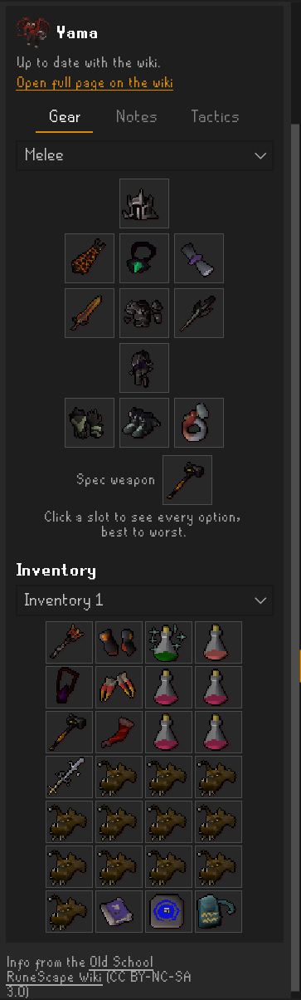
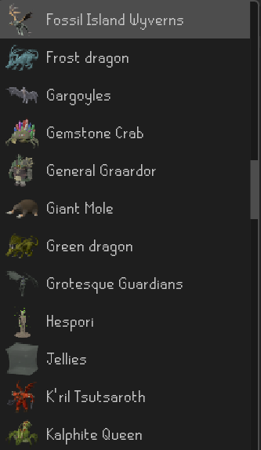
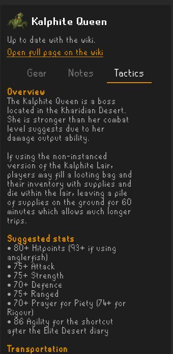

# Mob Strategy

Recommended gear, inventories and fight tactics for monsters and bosses from the
[Old School RuneScape Wiki](https://oldschool.runescape.wiki/), right inside RuneLite.
No more tabbing out to Google "zulrah strat" before every trip.

  
  
  

## Features

- **Search any monster or boss.** Results show up as you type, or browse the full list with pictures.
- **Gear grid.** Recommended equipment laid out like the in-game equipment screen, with item icons.
  Click a slot to see every option for it, best to worst.
- **Gear setups.** Switch between Melee, Ranged, Magic and other setups when the wiki has more than one.
- **Inventory.** The wiki's recommended inventory as a 4x7 grid.
- **Notes and Tactics tabs.** The wiki's gear notes, mechanics, phases and tips, formatted for the side panel.
- **Open my Slayer task.** One click opens the guide for your current Slayer task.
- **Works offline.** Guide info for about 90 monsters and bosses is built into the plugin.

Covers Slayer tasks and bosses that have a strategy page on the wiki. Raids, minigames and
skilling activities are left out on purpose; for those, the wiki itself is the better place.

## How to use

1. Click the **shield and sword** icon on the RuneLite sidebar.
2. Type a monster's name, pick one from the dropdown, or click **Open my Slayer task**.
3. Use the **Gear**, **Notes** and **Tactics** tabs. Click any gear slot to see all its options.
4. Click **Open full page on the wiki** if you want the whole page.

The **Open my Slayer task** button uses RuneLite's built-in Slayer plugin, so keep that plugin turned on.

## Settings

| Setting | Default | What it does |
|---|---|---|
| Live wiki lookups | Off | Gets the latest version of a guide from the OSRS Wiki when you open it, instead of only using the info built into the plugin. |

When **Live wiki lookups** is on, the plugin contacts the OSRS Wiki, which means your IP address
is sent to a server that isn't run by RuneLite. It's off by default for that reason.

## Credits

- Guide information, gear recommendations and monster pictures come from the
  [Old School RuneScape Wiki](https://oldschool.runescape.wiki/), used under
  [CC BY-NC-SA 3.0](https://creativecommons.org/licenses/by-nc-sa/3.0/).
- Parts of this plugin's code were written with the help of AI (Claude).

## For developers

The built-in guide info lives in `src/main/resources/com/mobstrategy/guides.json`, with monster
pictures in the `monsters` folder next to it. To refresh them from the wiki, run the `main` method in
`src/test/java/com/mobstrategy/GuideGenerator.java`. It only runs on the developer's computer, never
for players.

## License

[BSD 2-Clause](LICENSE)
